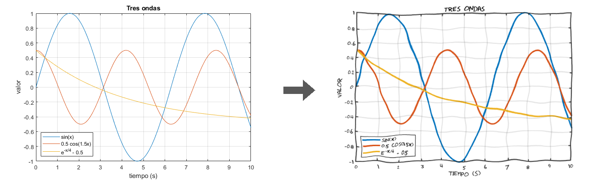
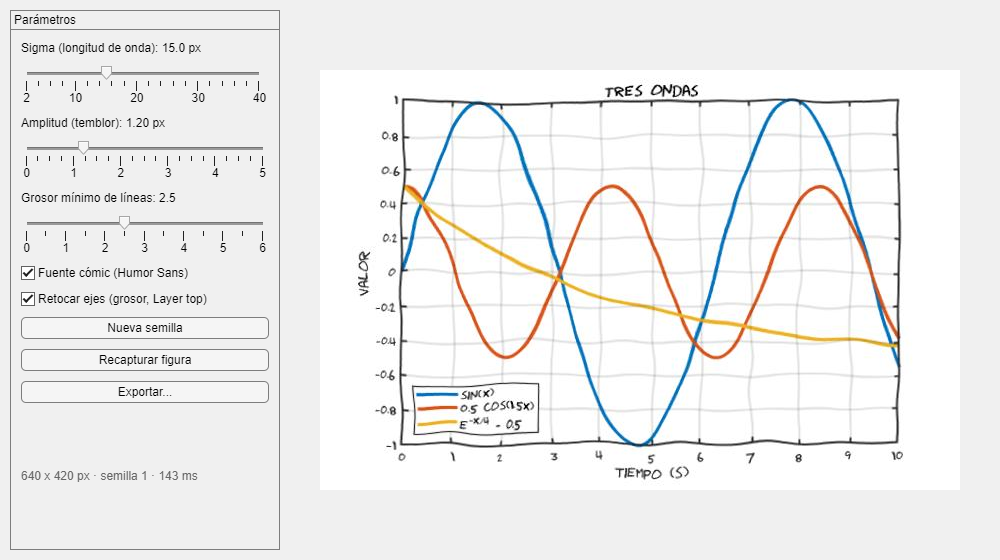

# xkcdify

Efecto "dibujado a mano", al estilo de los cómics de [xkcd](https://xkcd.com), para figuras de MATLAB.

**Antes → después**



La figura original no se modifica: `xkcdify` aplica unos retoques temporales (fuente cómic, grosores), captura la figura, la deja como estaba y deforma la captura con un campo de ruido suave.

## Uso

```matlab
hFig = figure('Color', 'w');
x = linspace(0, 10, 200);
plot(x, sin(x), x, 0.5*cos(1.5*x));
xlabel('tiempo'); ylabel('valor'); legend('sin', 'cos'); title('Demo');

xkcdify(hFig);                              % abre la interfaz
img = xkcdify(hFig, 'Amplitud', 2);         % sin interfaz: devuelve la imagen
imwrite(img, 'demo_xkcd.png');
```

La interfaz permite ajustar el efecto en vivo y exportar el resultado:



| Parámetro      | Por defecto | Qué hace                                               |
|----------------|-------------|--------------------------------------------------------|
| `Sigma`        | 15          | Longitud de la ondulación (px)                         |
| `Amplitud`     | 1.2         | Desplazamiento típico de los píxeles (px)              |
| `GrosorLineas` | 2.5         | Grosor mínimo de las líneas de datos (0 = no tocar)    |
| `FuenteComic`  | `true`      | Cambiar los textos a una fuente cómic                  |
| `RetocarEjes`  | `true`      | Engrosar los ejes y dibujarlos encima de los datos     |
| `Semilla`      | 1           | Semilla del ruido (misma semilla = misma imagen)       |
| `Interfaz`     | según salida | Abrir la interfaz (por defecto, solo si no se pide salida) |
| `TipoInterfaz` | `'auto'`    | `'uifigure'`, `'figure'` (clásica) o `'auto'`          |

## Instalación

```
git clone https://github.com/ezacur/xkcdify.git
```

o descarga el [ZIP](https://github.com/ezacur/xkcdify/archive/refs/heads/main.zip), y añade la carpeta al path de MATLAB con `addpath`.

## Requisitos

- MATLAB, sin ninguna toolbox.
- La interfaz usa `uifigure` (R2021b o posterior). En versiones anteriores, en Octave o si `uifigure` falla, usa una interfaz clásica con `figure` y `uicontrol`.
- Opcional: la fuente [Humor Sans](http://antiyawn.com/uploads/humorsans.html), la letra de xkcd, instalada para todos los usuarios. Si no está, usa xkcd Script, xkcd, Comic Neue o Comic Sans MS. Humor Sans no tiene tildes ni eñes.

## Documentación

El tutorial completo, con ejemplos de cada parámetro, está en [`doc/tutorial_xkcdify.html`](doc/tutorial_xkcdify.html): es un único fichero; descárgalo y ábrelo en el navegador. Se genera desde [`tutorial_xkcdify.m`](tutorial_xkcdify.m) con `build_tutorial`.
